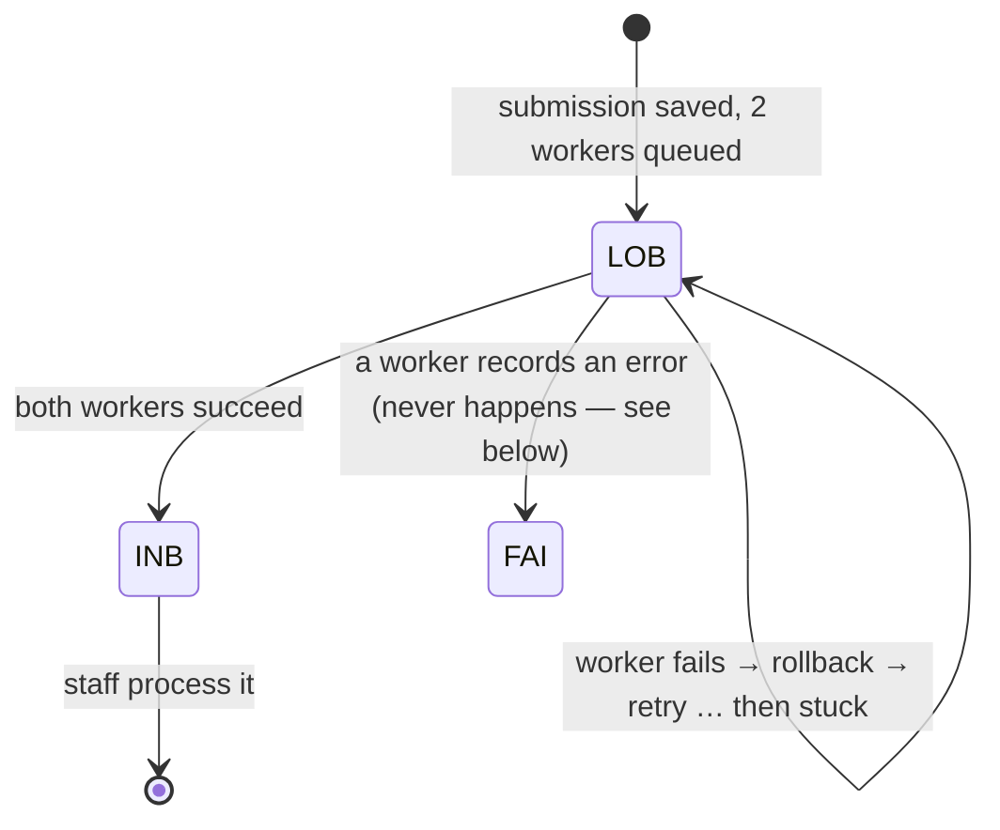

# Analysis: the recurring FTA data fixes

**Status:** analysis, for decision · **Date:** 2026-10-07

**Questions:**

1. `nr-fta-automatedb-datafix` runs two SQL fixes against `THE.TENURE_APPLICATION` again and again. What do we need to change so they stop being needed?
2. Across the 427 data fixes run from January 2024 to July 2026, what changes would make them unnecessary? See [All past data fixes: a ranked fix list](#all-past-data-fixes-a-ranked-fix-list).

## Short answer

Both fixes hide the same bug in the legacy submission service (`ftasvc`). It makes slow calls to the map services in background workers. When a call fails or hangs, the worker's transaction is rolled back. Nothing records the failure, so the row is left stuck. The SQL moves it along later.

The fix belongs in `ftasvc` and the legacy FTA web app, which still run. **nr-fta only reads these columns**; it doesn't port submission intake, Exhibit A rendering or map reports. Nothing in this repo needs to change for these two fixes. The wider list below is different: most of it lands in nr-fta.

Four changes would retire both data fixes:

1. Record a worker failure in its own committed transaction.
2. Put timeouts on the remote calls.
3. Let a stale "in progress" flag expire.
4. Replace the forced push to the inbox with a scheduled check that retries or fails.

The details are in [What it takes to fix](#what-it-takes-to-fix).

## The two data fixes

The fixes are a Liquibase changelog with `runAlways="true"`. They're started by hand from a GitHub Actions workflow that triggers a Jenkins job (`cd.io.nrs.gov.bc.ca`).

| Fix | SQL | Comment in the repo |
|---|---|---|
| `datafix001/IndicatorFlip.sql` | `IMAGE_CREATE_IN_PROGRESS_IND` `Y` → `N` where the state isn't FAI or REJ and `UPDATE_TIMESTAMP` is before yesterday; user `DATAFIX-INDFLIP` | "image create in process ind stuck" |
| `datafix002/UpdateStateCode.sql` | `TENURE_APPLICATION_STATE_CODE` `LOB` → `INB` where `UPDATE_TIMESTAMP` is over an hour old; user `DAILY_STATE_FIX` | "stuck due to BCGW timeout" |

## How a submission is meant to flow

The source paths below are under `fta-archive/ftasvc/trunk/source/` unless they start with `fta/`, which is under `fta-archive/`. Trunk and the newest tag (`5.1.0.2`) are identical for every file cited.

- **LOB** ("Lobby") and **INB** ("Inbox") are `TA_LOBBY_STATUS` and `TA_INBOX_STATUS` (`oracle/scripts/00/ddl/pkg/fta_submission.pks:23-24`). The staff inbox lists only INB (`fta/database/ddl/pkg/fta_300n_inbox.pks:820`).
- **Intake:** the submission is saved as LOB (`ear/.../dao/ApplicationDAO.java:172`). In the same transaction, `SubAgentSender` queues one message to each of two workers (`processors/SubAgentSender.java:75-110`).
- **RenderAgent** builds the Exhibit A PDF and a PDF per map feature. It calls the ArcGIS print service on `maps.gov.bc.ca`, which is backed by BCGW (`agents/renderagent/RenderAgent.java:463-499`, through `json/JsonMap.java`).
- **MapReportAgent** opens a Status & Clearance (SNCSC) request over REST (`agents/mapreportagent/MapReportAgent.java:177-182`).
- **Completion:** each worker sets its flag and calls `FTA_SUBMISSION.UPDATE_DRAFT` (`fta_submission.pks:1973-2040`). That procedure moves LOB → INB once both `image_created_ind` and `map_report_created_ind` are `Y`. It moves LOB → FAI if either error column is non-zero.

While an application is in LOB or INB, another submission for the same tenure is rejected (`PROC_TENURE_APP_EXISTS`, `fta_submission.pks:3650+`). A stuck row therefore also blocks resubmission.

## Why rows get stuck in LOB

- **The failure state is never reached.**
  - On any exception, both workers only send an ESF audit message (`agents/SystemAgent.java:193-208`) and return `false` (RenderAgent 502-529, MapReportAgent 186-195).
  - Returning `false` makes the ESF base agent roll back the session, which re-queues the message. This was confirmed from the `esf-baseagent-2.6.0` bytecode.
  - No Java code calls `IMAGE_ERROR_UPD` or `MAP_REPORT_ERROR_UPD`. RenderAgent's revision 1.30 note says those calls were removed from the exception handlers. As a result, the FAI branch of `UPDATE_DRAFT` is dead code.
  - Once the queue's retries run out, the application stays in LOB.
- **No timeouts.**
  - `JsonMap.java:240` polls the print job in `while (inProgress) Thread.sleep(1000)` with no limit.
  - None of its `HttpURLConnection`s (275, 303, 353) set connect or read timeouts.
  - The SNCSC `RestTemplate` beans (`resources/spring-listener-context.xml:24-60`) have none either.
  - A slow or hung BCGW can therefore hold a worker and its message for as long as it likes. This matches the "BCGW timeout" comment.
- **Uncaught errors.** MapReportAgent catches only `DAOException`, `AuthorizationServiceException` and `ValidationException`. A `RestClientException` or timeout escapes, and the same rollback follows.
- **Workers never queued.** `SubAgentSender.java:50-61` catches any exception while it builds or sends the worker messages and only writes an audit error. The LOB row commits with no workers coming.

**Forcing LOB → INB is not a retry.** It drops the application into the staff inbox. It may have no Exhibit A and no SNCSC request, and nothing tells staff. The only recovery is a manual Exhibit A regeneration in legacy FTA.

## Why the "image create in progress" flag gets stuck

- **Set to `Y`:**
  - Only a manual **Regenerate Exhibit A** in legacy FTA sets it (`fta/source/ear/.../web/frame/FtaAction.java:68`, called from the FTA950x, FTA300n and FTA133 screens).
  - `exaregen/RenderAgentMessageSender.java` queues the render job (`:87`), then runs `FTA_SUBMISSION.SET_IMAGE_REGEN_IN_PROGRESS` (`:92`, PKS 4362-4372).
  - The web request commits that on its own (`Fta950xTenAppAction.java:487`).
- **Set back to `N`:** only RenderAgent's success path does this (`setImageGenerationComplete`, `RenderAgent.java:492`). It happens inside the worker's transaction, so every failure path rolls it back:
  - **Render errors:** ArcGIS errors, a bad bounding box (`:549`) and DAO errors all return `false`, so the reset is rolled back.
  - **SNCSC call after a good render:** `RenderAgent.java:499` runs after the reset. If it throws, the `N` and the saved PDFs are rolled back too (`:522`).
  - **`NumberFormatException` (`:514-518`):** this branch has no `return false`. It falls through to `return true`, so the message is removed and the flag is never reset.
  - **Worker crash, redeploy or lost message:** nothing expires the flag.
  - **A small race:** the job is queued before the `Y` is written. A very fast render can have its `N` overwritten by the `Y`.
- **What a stuck `Y` blocks:**
  - Approve and Clear Exhibit A are refused (`Fta300nInboxForm.java:211-280`, `fta.web.error.usr.regenInProgress`).
  - The Regenerate and Upload Exhibit A buttons are disabled (`fta300nInbox.jsp:391-407`; `fta950xTenApp.jsp:525-535` via `disable_regen_upload_ind`, `fta_950x_ten_app.pks:242`).
  - Online retirement eligibility is affected (`FTA_ONLINE_RETIREMENT_IND.fnc:31`).
  - Users can't retry, so only the data fix unlocks the application.
- **The data fix's clock is wrong.** Setting `Y` doesn't touch `UPDATE_TIMESTAMP`. `IMAGE_CREATE_REQUESTED_DATE` is the column that records when it was requested.
- **Why FAI and REJ are excluded:** those applications are finished. REJ already disables regeneration (`fta_950x_ten_app.pks:240`), so a stale flag there is harmless.

## What it takes to fix

All of these are in legacy `ftasvc` unless marked otherwise.

| # | Change | Where | Retires |
|---|---|---|---|
| 1 | On a worker's final failure, write `IMAGE_ERROR_UPD` / `MAP_REPORT_ERROR_UPD`, call `UPDATE_DRAFT` (so the row goes LOB → FAI) and reset `IMAGE_CREATE_IN_PROGRESS_IND`. Do it **in a separate committed transaction**, because ESF rolls back the main one. Notify on FAI. | `RenderAgent`, `MapReportAgent`, `SystemAgent.handleProcessingError` | both, mostly |
| 2 | Connect and read timeouts on `JsonMap`'s connections; a maximum wait on the polling loop (then throw `RenderAgentException`); a timeout request factory on the SNCSC `RestTemplate`s; a limited retry with backoff, in code or through the queue's `max_retries` / `retry_delay` | `json/JsonMap.java`, `spring-listener-context.xml` | LOB |
| 3 | Make the SNCSC call after rendering non-fatal (catch and log, or move it out of the deciding transaction) | `RenderAgent.java:497-500` | flag |
| 4 | Small fixes: `return false` in the `NumberFormatException` branch; a catch-all in `MapReportAgent`; treat a failed queue send in `SubAgentSender` as a failure, not just an audit entry; set the flag before queuing the render job, in the same commit (legacy FTA web) | `RenderAgent`, `MapReportAgent`, `SubAgentSender`, `RenderAgentMessageSender` | both |
| 5 | Treat `IMAGE_CREATE_IN_PROGRESS_IND = 'Y'` as stale once `IMAGE_CREATE_REQUESTED_DATE` is more than N minutes old, so the Regenerate button comes back by itself. This covers worker crashes, which no code fix inside the worker can. | `FTA_GET_REGEN_IN_PROGRESS_IND`, the `fta_950x` / `fta_300n` queries (legacy FTA DB) | flag |
| 6 | Replace the data fix repo with a scheduled check. It re-queues stale LOB applications to whichever worker hasn't finished, and marks them FAI after N attempts. It **never** forces them to INB. | `ftasvc` scheduled job or DB job | safety net |

Items 1 and 2 do most of the work. Item 5 retires the indicator flip on its own. Item 6 is for whatever still slips through, and replaces a hand-run pipeline that hides failures with one that reports them.

## All past data fixes: a ranked fix list

The two fixes above are a small part of the picture. The data fix archive holds **427 fixes from January 2024 to July 2026**: 161 in 2024, 191 in 2025 and 75 so far in 2026. Each was classified from its readme and SQL by what it changed and by what would most likely have prevented it.

### What would have prevented them

| Cause | Fixes | Share |
|---|---|---|
| The app can't make a legitimate change | 180 | 42% |
| An integration failed (SNCSC, RRS, ESF workers, queues, BCGW) | 110 | 26% |
| A business action left tables half-updated | 64 | 15% |
| A bulk change with no tool to do it | 20 | 5% |
| Bad data let in by missing validation | 19 | 4% |
| No admin screen for reference data | 12 | 3% |
| Government reorg | 2 | <1% |
| Genuine one-off correction | 20 | 5% |

**About 95% point to a fixable cause.** The biggest share, the app being unable to make a legitimate change, is mostly screens nr-fta is rebuilding.

### What they changed

| Area | Fixes |
|---|---|
| District, region or admin org (39 of them are billing swaps; see #4) | 59 |
| SNCSC and FTA out of sync | 55 |
| Submission state moved, rejected or rolled back by hand | 55 |
| Cutting permit and file dates (expiry, extension, postponement) | 51 |
| Status changes on files, permits, marks and blocks | 41 |
| Missing cross-reference or child records | 34 |
| File, tenure or licence type | 30 |
| Deleting wrong, duplicate or orphan records | 16 |
| Transfers | 13 |
| Billing, batch and queue processing | 12 |
| Reference data | 12 |
| Clients | 11 |
| Range | 9 |
| Recreation | 9 |
| Exhibit A regeneration | 2 |
| Other | 18 |

### Ranked fixes

Counts in this table are approximate. One fix can match more than one row, and many readmes were copy-pasted, so classification often came from the SQL instead. Folder names (the ticket numbers) are given as examples.

| # | Fix | Data fixes it removes | Where |
|---|---|---|---|
| 1 | **Make SNCSC's results reach FTA reliably.** Handle each approval or rejection idempotently, so repeating it is safe, and add a scheduled check that replays any missed one. About 20 scripts hand-approve the same five tables (TENURE_APPLICATION, ELECTRONIC_SUBMISSION, HARVESTING_AUTHORITY, CUT_BLOCK, HARVEST_AMEND) and move the file to HN "so Issue Permit becomes available" (FTA-2016, FTA-2034, FTA-2103, SD-110118, FTA-2620). Others clear SNCSC tasks left frozen or corrupted (FTA-2182, FTA-2209). | ~55 | SNCSC integration (the FTA tenures API in ISSS), plus a scheduled check in nr-fta |
| 2 | **Add a proper "reject / roll back submission" action.** It should run in one transaction, delete the blocks, geometry and open-admin rows, and keep the mark records. About 11 near-identical scripts handle "SNCSC rejected but FTA approved" by setting REJ and hand-deleting those rows (FTA-2292, FTA-2339, FTA-2370, FTA-2386). Rejecting also loses hauling authority, timber mark and cross-reference rows, which blocks resubmitting or issuing (FTA-2371, FTA-2389, FTA-2407). Sometimes it leaves a hauling authority behind instead (FTA-2308). | ~60 | the approve/reject database package (`FTA_SNC_MANAGEMENT`), plus the inbox screen in nr-fta |
| 3 | **Fix the code that leaves records without their child rows:** • SNCSC's blanket road marks get no HAULING_AUTHORITY (FTA-2098); • rejects drop HARVESTING_HAULING_XREF (FTA-2440, FTA-2535, FTA-2579); • `cut_block_open_admin` rows end up with no `cb_skey`, so RESULTS data doesn't show (FTA-2618); • transfer scripts skip the timber_mark trigger (FTA-2218). Then add a daily consistency report and, after a clean-up, NOT NULL / foreign key constraints. | ~35 | database packages, SNCSC workflow, transfer function |
| 4 | **Add a coast/interior billing zone that HBS reads,** instead of the district. Marks are switched DKM↔DNI or DCK→DCS so HBS bills the right grade, then switched back, every billing cycle and always in two parts (SD-129887, SD-134985, SD-146541, SD-157640). | **~39** | HBS plus one FTA attribute. **The best payoff for the effort.** |
| 5 | **Cutting permit dates and postponements:** • allow editing expiry and post-expiry with an audit trail; • recalculate expiry when a postponement is rescinded (SD-126489, SD-127434); • remove the need to reset the CP before entering a postponement (SD-126467, SD-141602); • let HQ override the 4-year term rule, with a reason (FTA-2139, SD-146239). One of these fixes needed its own fix because it altered the wrong field (SD-151875). | ~50 | nr-fta (CP screens) |
| 6 | **Add a guarded "change file type" action** with an allowed-conversions table: A01→A41 (the most common: SD-169879, SD-179134), U2→U1 (SD-168804), and B07↔B20 with B07's LICENCE_TO_CUT row handled automatically (SD-148520, SD-139959). | ~30 | nr-fta (admin) |
| 7 | **Allow editing district, region and admin org on the file,** with the change carrying through to its permits, marks and range tenure (SD-161538, SD-168203, SD-163636). One fix needed two passes because only `prov_forest_use` was changed (SD-175326). | ~20 | nr-fta |
| 8 | **Status changes:** • allow the legitimate transitions in the app, such as FLTC/B07 from PA/PI to EE after SNCSC rejects (SD-143121, SD-143586) and closing old special-mark tenures (FTA-2207); • carry permit status down to blocks and marks (FTA-2184, FTA-2251; FTA-2253 for road marks); • add a bulk-close tool for obsolete tenure types, done today in two or three rounds (SD-164073, SD-175730, SD-157449). | ~40 | nr-fta |
| 9 | **Rebuild intake without ESF**, which is already required ("No dependency on ESF"): • failure states and timeouts, so nothing sticks in LOB (FTA-1959, FTA-1977) and no stale queue rows block new submissions (FTA-2131, FTA-2467); • clean special characters at intake, which broke range submissions three times (SD-122388, FTA-2128); • refuse to reuse a forest file ID that has rejected applications (FTA-2380). | ~30 | the `ftasvc` replacement (see the sections above) |
| 10 | **Add a transfer function** for TFL and company transfers: new hauling authority, mark transfer, cross-references and moved blocks (FTA-2176, FTA-2183, FTA-2218, FTA-2359). The hand-written transfer scripts caused their own follow-up fixes: a wrong file ID (FTA-2201), a missing timber mark (FTA-2218) and a duplicate map feature ID (FTA-2133). | ~13, plus follow-ups | nr-fta |
| 11 | **RRS→FTA sync:** client changes (FTA-2342), closures (FTA-1964, where billing kept running on a closed SUP) and rent fees (FTA-1950) that don't arrive, and stuck RRS queue messages and retry settings changed by hand (RRS-2806, FTA-2468). Add retry with alerting, plus a reconciliation report. | ~17 | RRS integration |
| 12 | **Client changes:** • bulk-assign O-level clients to blocks (FTA-2307 and FTA-2406, 559 and 225 blocks); • end-date licensees properly; • keep FOR_CLIENT_LINK and FOREST_FILE_CLIENT in step (SD-163231 had to be redone because the screen reads the other table); • fix the batch job that misses timber mark client changes (FTA-1963, FTA-2473). | ~11 | nr-fta and the batch job |
| 13 | **Admin screens for reference data:** management units, including RESULTS/APT (FTA-2456, FTA-2367), codes, error messages and mark designations. FTA also gives new TFLs the wrong mark designation (FTA-2495), which is a defaults bug. | ~12 | nr-fta (admin) |
| 14 | **Range and recreation bugs:** • range special conditions not saving (FTA-2598); • no cut block or FUP without spatial (FTA-2100); • the salvage indicator locking the sale volume fields (SD-160020); • recreation pending map features needing hand rollback (FTA-2592, FTA-2594); • recreation replication failing on a duplicate comment (FTA-2101). | ~18 | nr-fta and database packages |

**Process changes alongside the fixes:**

- **Tag every data fix:** put the ticket and a category code in `UPDATE_USERID`, so the count can be tracked as these land.
- **Write real readmes:** most readme summaries are copy-pasted and wrong, and three folders are empty.
- **Peer review every script.**

### Where to start

1. **#4, the HBS billing zone.** One small change removes about 39 fixes.
2. **#1 and #2, SNCSC sync and a proper reject action.** Together about 115 fixes, about a quarter of the total.
3. **#5–#8, built into the nr-fta screens we're already porting.** About 140 fixes.
4. **#9 as part of the ESF replacement, and #3's consistency report.**

## Before starting

- **Size the problem.** Count the rows the fixes touch: `UPDATE_USERID IN ('DAILY_STATE_FIX', 'DATAFIX-INDFLIP')` on `THE.TENURE_APPLICATION`, by month.
- **Find the dominant failure.** The RenderAgent and MapReportAgent logs, or the ESF audit messages for the stuck applications, will show which path happens most (timeouts, ArcGIS errors or SNCSC).
- **Read the queue settings.** Get the AQ retry and exception-queue settings for both queues. The queue DDL isn't in these repos.
- **Confirm the deployed version.** Check that deployed `ftasvc` matches trunk / `5.1.0.2`. Also confirm whether anyone still maintains and deploys it; that decides between patching it and rebuilding intake.

## Not confirmed

For the ranked list:

- **Approximate counts:** the classification was done from readmes and SQL. Most readmes are copy-pasted boilerplate, so many fixes were judged from their SQL comments.
- **Overlap:** a fix can fall under more than one row, so the ranked counts overlap and don't add up to 427.

For the two stuck-submission fixes:

- **Production failure paths:** that production failures go through these exact paths. There are no logs to check.
- **Queue retry behaviour:** how the ESF `QueueAgent` handles retries and dead letters. The library source isn't in these repos.
- **SNCSC and BCGW:** whether SNCSC calls BCGW internally.
- **Concurrency:** a race between the two workers was ruled out. Both update the same row, so the row lock puts them in order.
