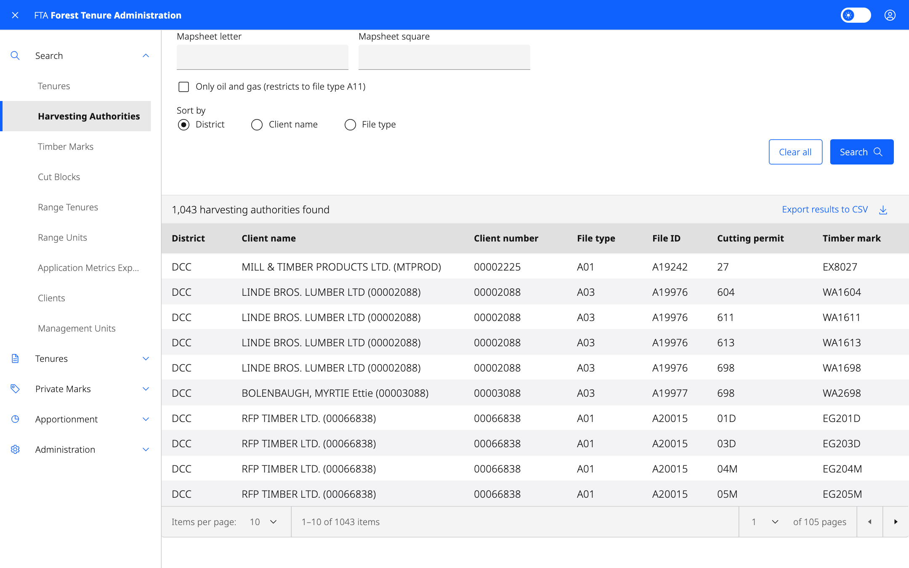
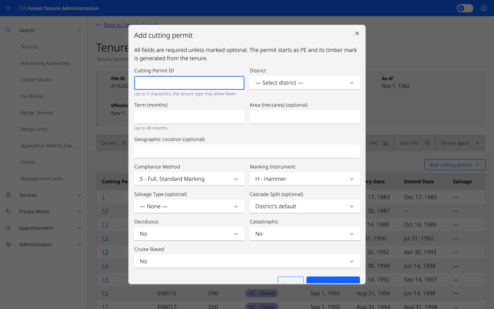
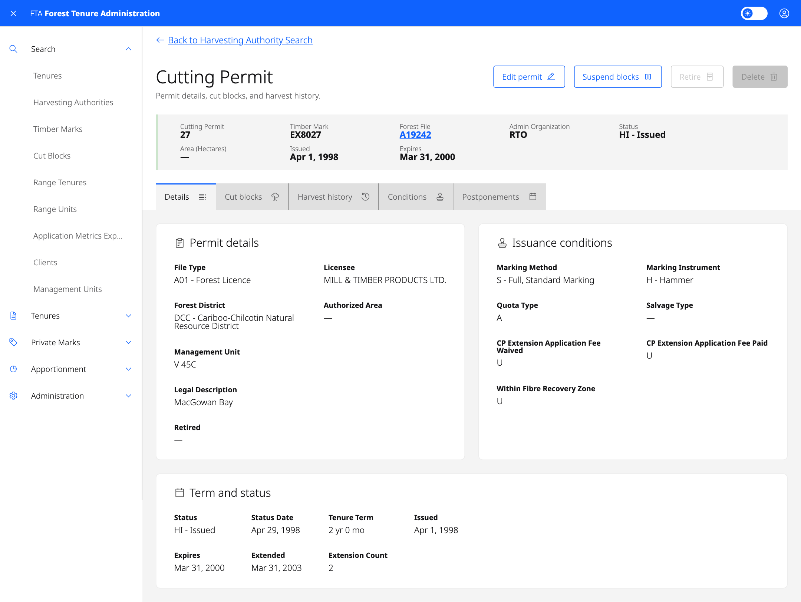
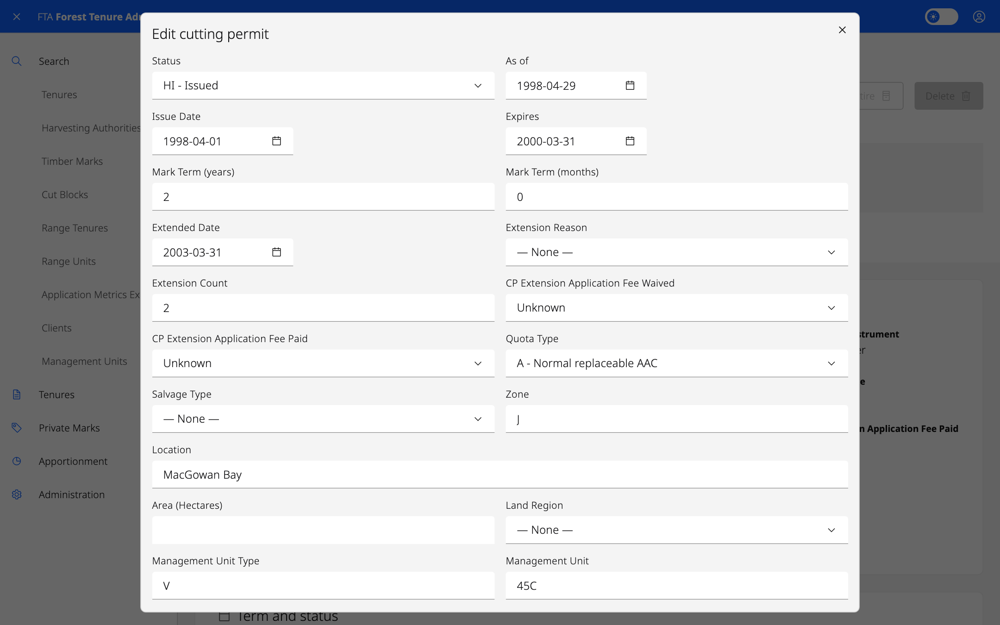
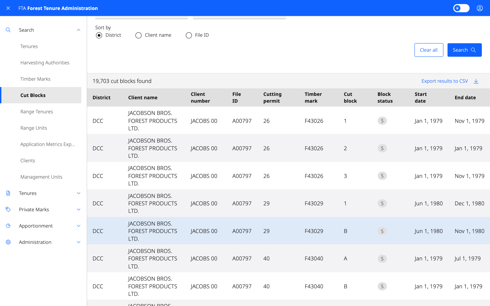
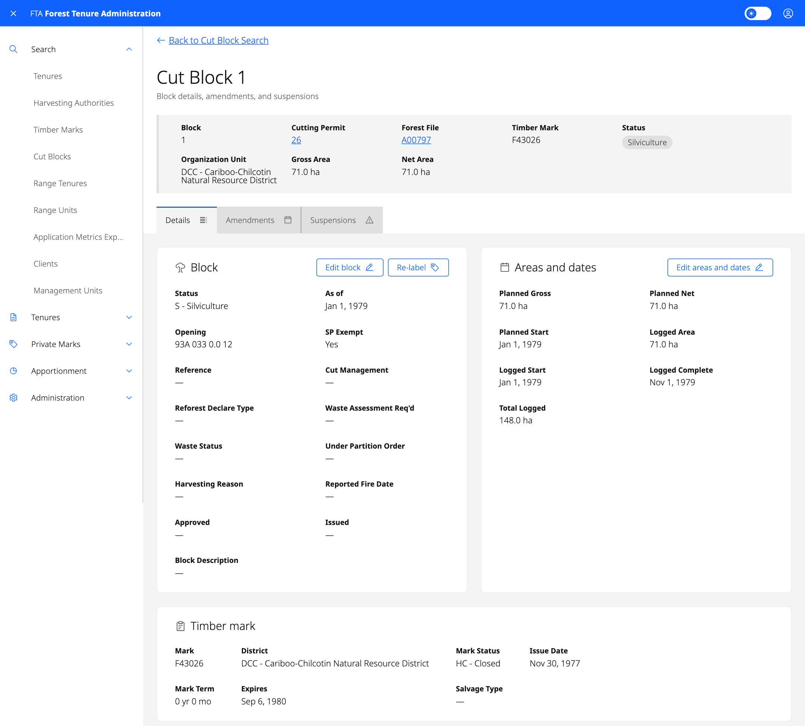

# Harvest Authorities guide for District Administrators

For **Harvest Authorization District Administrators**. Harvest authorities
are the cutting permits issued under a timber tenure and the cut blocks
harvested under them. You find permits and blocks, add a cutting permit to a
tenure, keep a permit's details up to date, retire closed permits, and add
and edit cut blocks. You can work on permits and blocks in any district.

Some changes need a senior role: changing an issued permit's terms,
postponements, conditions, suspensions, and deleting or re-labelling. They
are in the Harvest Authorities guide for Senior Administrators.

## Getting started

Open FTA and select **Log in with IDIR**. After you sign in, the
**Welcome** page opens. Use the menu on the left to get around: the harvest
screens are under **Search** (**Harvesting Authorities**, **Cut Blocks**,
**Tenures**) and **Tenures** (**Tenure List**). Your name and role are shown
in the profile panel at the top right.

## Screens

| Menu item | Use it to |
|---|---|
| **Search › Harvesting Authorities** | Find cutting permits by district, file, permit, timber mark, client, status, dates or oil and gas details. Select a row to open the permit. |
| **Search › Cut Blocks** | Find cut blocks by district, file, permit, timber mark, block, client, status or harvest dates. Select a row to open the block. |
| **Search › Tenures** | Find a tenure, then work with its permits and blocks on the **Cutting permit / mark**, **Cut block** and **CP/CB amendments** tabs. |
| **Tenures › Tenure List** | Open a tenure directly by its **Forest File ID**. |

## Common tasks

### Find a cutting permit

1. Select **Search › Harvesting Authorities**.
2. Enter your criteria. The page needs one of these:
   - a **Timber mark** on its own. A valid mark ignores every other
     criterion.
   - a **File ID** with a **Cutting permit**, or a **File ID** with an
     **HVA ID** (not both).
   - otherwise, at least two criteria, one of which is **District**.
3. Narrow the search further with **File type**, **Cutting permit status**,
   **Client**, **Client type**, **Management unit**, **Salvage type**,
   **Zone**, and the **Date ranges** (**Issue date from/to**, **Expiry date
   from/to**).
4. Choose a **Sort by** order (**District**, **Client name** or **File
   type**) and select **Search**.

**File ID**, **Cutting permit**, **HVA ID** and **Timber mark** match in upper
or lower case. In **Client**, type at least three characters of a client
number or name and pick from the list; it lists clients with that text
anywhere in their number or name. Searching without picking matches every
client whose name contains the text.

The results list each permit's **District**, **Client name**, **Client
number**, **File type**, **File ID**, **Cutting permit** and **Timber mark**.
Select a column heading to sort by it. Select **Export results to CSV** to
download every matching row. Select a row to open the cutting permit.

For oil and gas permits, use the **Oil and gas criteria** (**Invoice
number**, **App determination number**, **Geographic identifier**,
**Purpose**, and the NTS and mapsheet fields). Tick **Only oil and gas
(restricts to file type A11)** to see only those permits. The extra columns
(**OGC number**, **NTS**, **NTS mapsheet**, **Program number**,
**Geographic identifier**) appear when that box is ticked or the **File
type** is A11.

**Clear all** empties the form. FTA remembers your criteria and last search
while the browser tab stays open.

### Add a cutting permit to a tenure

1. Open the tenure from **Search › Tenures** or **Tenures › Tenure List**.
2. Select the **Cutting permit / mark** tab. It lists the tenure's permits
   with their **Timber Mark**, **District**, **Status**, **Issue Date**,
   **Expiry Date**, **Extend Date** and **Salvage**.
3. Select **Add cutting permit**. The button is available on timber tenures
   (file types starting with A).
4. Complete the **Add cutting permit** dialog:
   - **Cutting Permit ID**: up to 3 characters. The tenure type may allow
     fewer, and the ID can't already be in use on the tenure.
   - **District**: starts as the tenure's own organization unit when that is
     a district; otherwise choose one.
   - **Term (months)**: 1 to 48 months (1 to 60 for an A11).
   - **Area (Hectares) (optional)** and **Geographic Location (optional)**, up to 50
     characters.
   - **Compliance Method** and **Marking Instrument**. They start as full
     standard marking with a hammer. The instrument is optional only for
     method E.
   - **Salvage Type (optional)**. It is always SSS for an A31, and must be
     SSS when the forest licence is for salvage.
   - **Cascade Split (optional)**. Leave it as **District's default** unless
     told otherwise.
   - **Deciduous**, **Catastrophic** and **Cruise Based**: **No** or **Yes**.
     They start as **No**.
5. Select **Add cutting permit**.

FTA generates the permit's timber mark from the tenure and confirms it in the
message. The new permit starts in status **PE**.

### Work with a cutting permit

Open a permit from **Search › Harvesting Authorities**, from the tenure's
**Cutting permit / mark** tab, or from a cut block. The summary at the top
shows the **Cutting Permit**, **Timber Mark**, **Forest File** (a link to
the tenure), **Admin Organization**, **Status**, the area (**Schedule B (ha)** or **Area (ha)**),
**Issued** and **Expires**. The coloured bar on its left matches the status.

The tabs are:

| Tab | What it shows |
|---|---|
| **Details** | **Permit details** (including the area, **Zone**, **Land Region** and **Geographic Location**), **Issuance conditions** (including the fee, **Within Fibre Recovery Zone**, **Deciduous**, **Catastrophic** and **Cruise Based** answers), and **Term and status** (status, tenure term, issue, expiry and extension dates, extension reason and count). The area is **Schedule B (ha)** on file types A02, A04, A44, A28 and A29, with **Schedule A (ha)** (private land) beside it, and **Area (ha)** on the rest. |
| **Cut blocks** | The permit's blocks with their status, salvage type, harvest dates and areas. Select a block to open it. Blocks are added on the tenure's **Cut block** tab. |
| **Harvest history** | What has been billed to the permit's timber mark, by calendar year. |
| **Conditions** | The permit's issuance conditions. View only for you. |
| **Postponements** | The permit's harvesting postponements. View only for you. |

The action buttons at the top depend on the permit's status (see
[Statuses](#statuses)):

| Button | What it does |
|---|---|
| **Edit permit** | Change the permit's status, dates and other fields. |
| **Assign marks to blocks** | Give each block one of the permit's timber marks. Shown only on Fort St. John authorizations, which carry several marks. |
| **Retire** | Retire a permit in status HC or HRS. |
| **Delete** | Disabled for you; deleting a permit needs a senior role. |

### Edit a cutting permit

1. On the permit, select **Edit permit**.
2. Change what you need in the **Edit cutting permit** dialog and select
   **Save**.

FTA locks the fields that can't change for the permit's status or your role:

- **Status** and **As of**: editable, but you can't change a status into or
  out of **HP** (postponement). A Senior Administrator does that.
- **Issue Date**, **Expires**, **Mark Term (years)**, **Mark Term (months)**
  and **Extension Count**: you can change them until the permit is issued.
  On **HN** they are still open; on any other status starting with H they
  are locked for you.
- **Extended Date** and **Extension Reason**: only on an issued permit
  (status starting with H) that is not **HP**. A new extended date resets
  the two **CP Extension Application Fee** answers to blank. Setting
  **Waived** to **Yes** sets **Paid** to **No**.
- **Schedule B (ha)** or **Area (ha)**: only while the permit is **PP**, **PL** or **PI** and
  has no mapped area.
- **Compliance Method** and **Marking Instrument**: not on Fort St. John
  authorizations.
- **Purpose**: shown only for file type A18.

The other fields (**Quota Type**, **Salvage Type**, **Zone**, **Geographic Location**,
**Land Region**, **Management Unit Type**, **Management Unit**,
**Deciduous**, **Catastrophic**, **Cruise Based** and **Within Fibre Recovery
Zone**) can be changed whenever the permit can be saved. **Catastrophic** is
required on a tenure awarded before April 1, 2006, unless you save the permit
as **EE** or **HX**. If FTA
saves the permit with warnings, they appear in the confirmation message.

### Retire a cutting permit

**Retire** is available when the permit is **HC** or **HRS**, is not already
retired, and has no application in progress. Confirm **Retire**. The
**Retired** date then shows on the **Details** tab.

### Assign timber marks to blocks

On a Fort St. John authorization:

1. On the permit, select **Assign marks to blocks**.
2. To give every block the same mark, choose it under **Assign mark to all
   blocks** and select **Assign mark to all**.
3. To set marks block by block, choose a **Timber Mark** on each row of the
   **Blocks** table and select **Save assignments**.

You can choose from the permit's existing marks. Giving a block a new mark
needs a senior role.

### Find a cut block

1. Select **Search › Cut Blocks**.
2. Enter any of **District**, **Zone**, **File ID**, **Cutting permit**,
   **Timber mark**, **Cut block**, **Client**, **Block status**, **Managed by
   file**, **Managed by cutting permit** (needs a **Managed by file**), and
   **Harvest date from/to**.
3. Choose a **Sort by** order (**District**, **Client name** or **File ID**)
   and select **Search**.

The results list each block's **District**, **Client name**, **Client
number**, **File ID**, **Cutting permit**, **Timber mark**, **Cut block**,
**Block status**, **Start date** and **End date**. Select **Export results to
CSV** to download them, and select a row to open the block.

### Add a cut block to a tenure

1. Open the tenure and select the **Cut block** tab. It lists every block on
   the tenure. When the tenure has several permits, filter the list by
   cutting permit. Any block suspensions are listed below the blocks under
   **Cut block suspensions**.
2. Select **Add cut block**. Blocks can be added only to a salvage cutting
   permit, or to a B04 or B07 with a purpose of SS, and not while the permit
   is **PE**.
3. In the **Add cut block** dialog, choose the **Cutting permit**, enter the
   **Cut Block** (up to 10 characters), **Planned Gross Area (ha)**,
   **Planned Net Area (ha)**, **SP Exempt** and **Waste Assessment
   Required**, plus any optional fields.
4. Select **Add cut block**.

The block starts in status **PP** under the permit's timber mark. For
salvage blocks the planned areas must be under one hectare, and the planned
net area can't be more than the planned gross area.

Deleting a cut block needs a senior role.

### Review cut block amendments

On the tenure's **CP/CB amendments** tab, each amended block shows its
**Total Amend to Net (ha)**, **Total Amend to Gross (ha)** and **Total Amend
to Cruise (m³)**. Select **Amend details** to see the block's amendments,
and **All amended blocks** to go back. The tab is read-only. A block's own
**Amendments** tab shows the same list.

### Work with a cut block

Open a block from **Search › Cut Blocks**, a permit's **Cut blocks** tab, or
the tenure's **Cut block** tab. The summary shows the **Block**, **Cutting
Permit** (a link to the permit), **Forest File**, **Timber Mark**,
**Status**, **Organization Unit**, **Gross Area** and **Net Area**.

The tabs are:

| Tab | What it shows |
|---|---|
| **Details** | The **Block** tile (status, opening, SP exempt, cut management, waste, partition order, fire details, approval and issue dates, description), the **Areas and dates** tile (planned and logged areas and dates) and the **Timber mark** tile. |
| **Amendments** | Each amendment of the block. Amendment 0 is the original. |
| **Suspensions** | The block's partition order suspensions. |

### Edit a cut block

1. On the block's **Details** tab, select **Edit block** on the **Block**
   tile, or **Edit areas and dates** on the **Areas and dates** tile.
2. Make your changes and select **Save**.

Some fields lock depending on the block:

- **Status** can't change while the block is **PE**, or when its file is
  **HX** or **HC**.
- **Planned Gross (ha)** and **Planned Start** are locked when the block has
  a mapped area.
- **Logged Area (ha)**, **Logged Start**, **Logged Complete** and **SP
  Exempt** are locked when the block has an opening.
- A block in status **LC** needs a logged area, and the **Logged Complete**
  date is required when you change the status to **LC**.

## Statuses

The screens show each status as its code and description, for example
**HI - Issued**. The colour of the tag shows the status's stage. These are the
statuses that change what you can do:

| Status | Description | What it means for you |
|---|---|---|
| **PE** | Pending Electronic | Where a new cutting permit starts. Nothing on a PE permit or block can be edited, and blocks can't be added to it. |
| **PP** | Proposed | A permit's area can still be changed. A new cut block starts here. |
| **PL** | Planned TSL | A permit's area can still be changed. |
| **PI** | Pending Issuance | A permit's area can still be changed. |
| **HN** | Issued but Not Printed | You can still change the permit's terms. |
| **HI** | Issued | The permit's terms are locked for you. |
| **HP** | Harvesting Postponement | Set by a Senior Administrator. Terms and extensions are locked. |
| **LC** | Logging Complete | A block in LC needs a logged area. |
| **HC** | Closed | The permit can be retired. A block's status can't change while its file is HC. |
| **HRS** | Harvesting Rights Surrendered | The permit can be retired. |
| **HX** | Cancelled | A block's status can't change while its file is HX. |
| **EE** | Entered In Error | The permit can't be edited. |

Issued permits (statuses starting with H) can have an **Extended Date**,
except while they are **HP**. Other codes, such as **DD** Disallowed by
District or **HD** Harvesting Deferred, appear in the status lists but don't
change what you can do on these screens.

Oil and gas permits (file type A11) are read-only for everyone.

## What you can do

| Task | Harvest Authorization District Administrator |
|---|---|
| Search permits and cut blocks; open their details | Yes, any district |
| Add a cutting permit; edit a permit | Yes |
| Change a permit's terms | Until it is issued (and on HN) |
| Retire a permit | Yes |
| Assign marks to blocks | The permit's existing marks |
| Add a cut block; edit a cut block | Yes |
| Change a status into or out of HP; postponements; conditions | No; a Senior Administrator does these |
| Delete a permit; delete or re-label a cut block; suspensions | No; a Senior Administrator does these |
