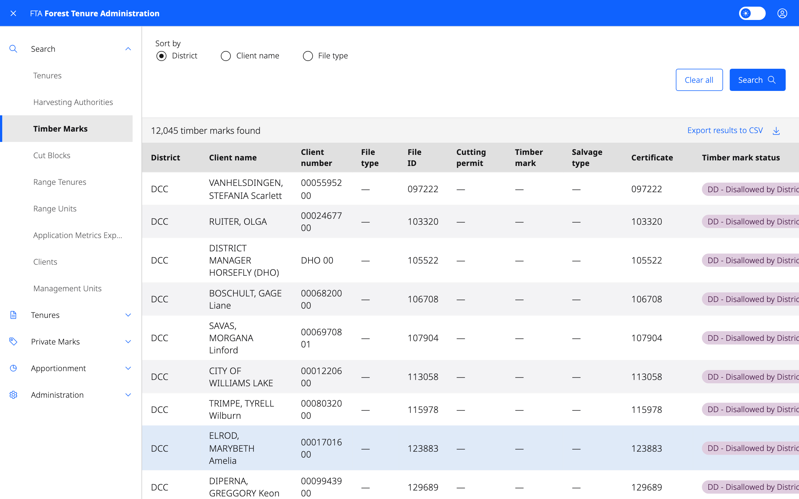
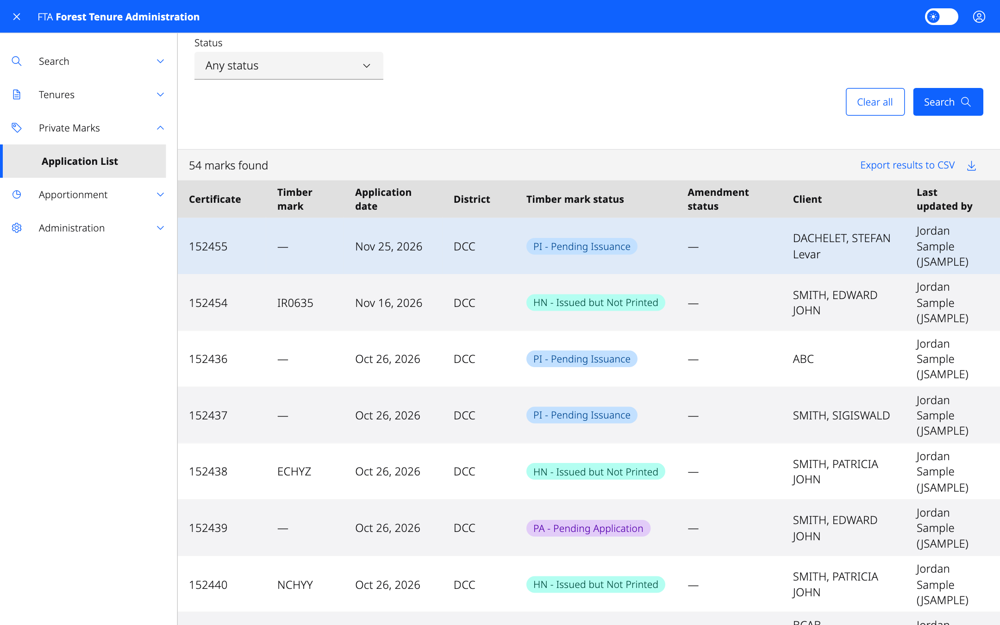
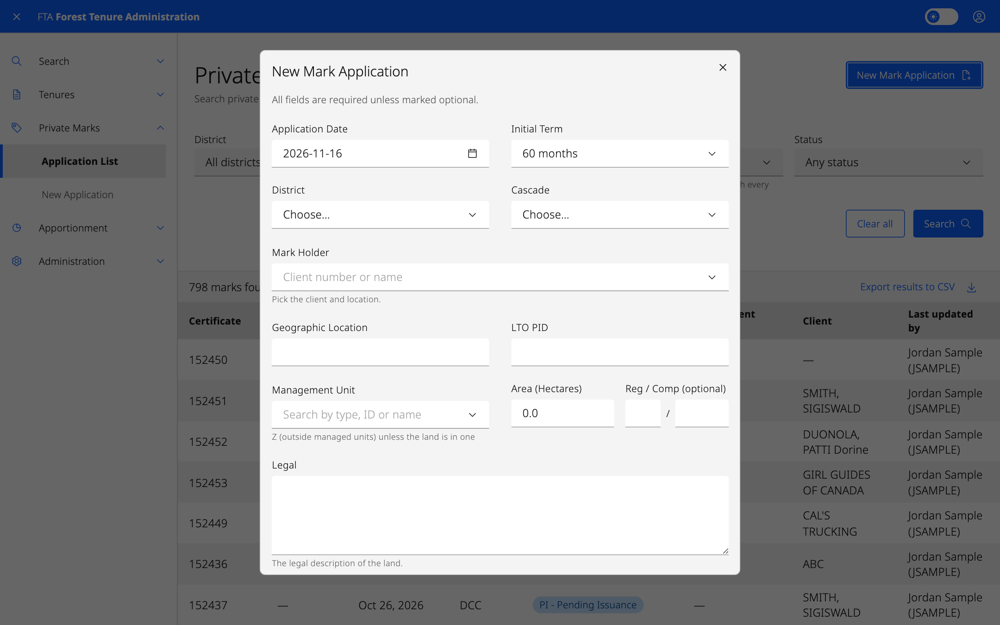
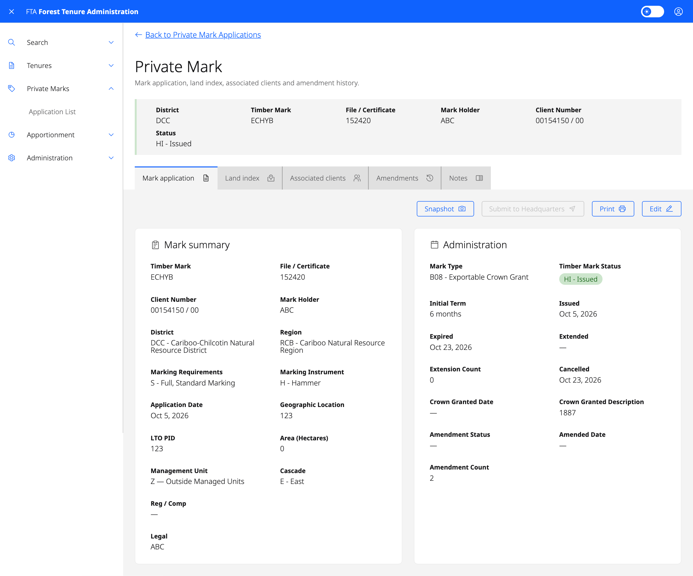
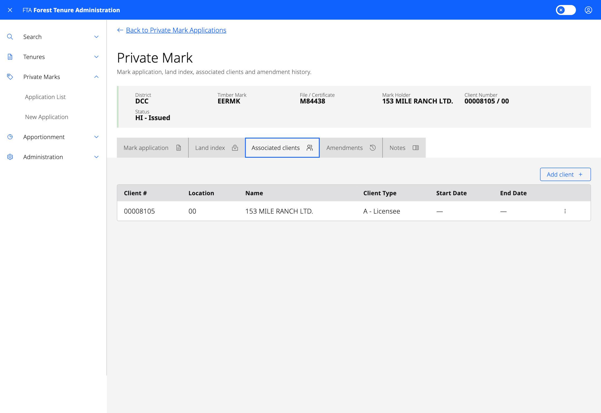
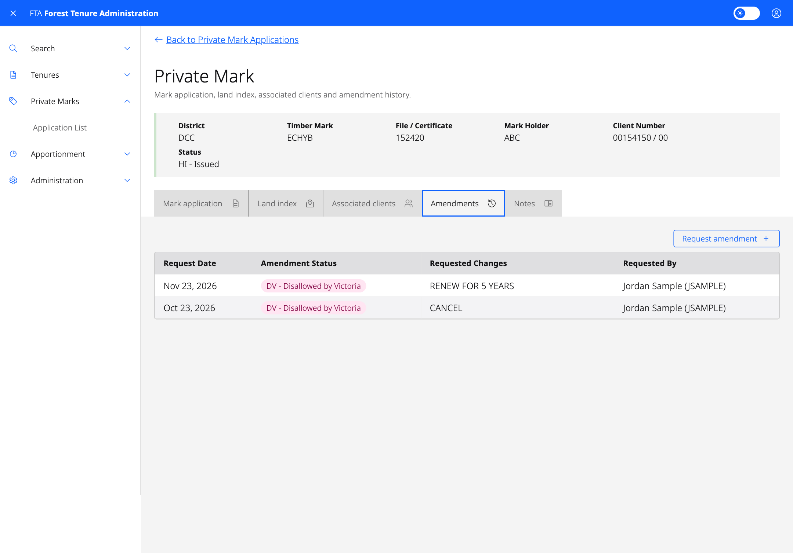

# Timber Marks guide for District Administrators

For **Timber Mark District Administrators**. You find timber marks, enter
private mark applications for your district and send them to Headquarters.
Once Headquarters has issued a mark, you print its certificate, request
amendments and reinstate a cancelled mark.

Headquarters reviews applications, issues timber marks and approves
amendments. Their side of the work is in the Timber Marks guide for
Headquarters Administrators.

## Getting started

Open FTA and select **Log in with IDIR** on the landing page. After you sign
in, the **Welcome** page opens. Use the left menu to reach the screens below.
Your name and role are in the profile panel at the top right.

Your menu shows **Search › Tenures**, **Search › Timber Marks** and
**Private Marks**. The tenure and cutting permit pages a search opens are
read-only for you.

## Screens

| Where to find it | Use it to |
|---|---|
| **Search › Timber Marks** | Find timber marks by district, management unit, file, cutting permit, mark, status, client, salvage type, dates and private mark details. Open a result, or export the results to CSV. |
| **Private Marks › Application List** | List private mark applications and amendments by district, timber mark, client or status, and open one. |
| **Private Marks › New Application** | Start a new private mark application. |

## Common tasks

### Find a timber mark

1. **Search › Timber Marks**.
2. Enter any of the criteria:
   - **District**, **Management unit**, **File ID**, **Cutting permit**,
     **Timber mark**, **File type**, **Mark status**, **Client**,
     **Client type**, **Salvage type** and **Zone**.
   - Under **Date ranges**: **Issue date from** / **to** and
     **Expiry date from** / **to**.
   - Under **Private mark criteria**: **Certificate**, **Land district**,
     **Primary ID**, **Primary detail**, **Amended date from** / **to**, and
     **Only private marks**.
3. Choose a **Sort by** order (**District**, **Client name** or
   **File type**).
4. Select **Search**.

Things to know:

- A valid **Timber mark** ignores every other criterion.
- **File ID**, **Cutting permit**, **Timber mark** and **Certificate** match
  in upper or lower case.
- In **Client**, type at least three characters of a client number or name
  and pick from the list; it lists clients with that text anywhere in their
  number or name. If you search without picking, every client whose name
  contains the text is matched.
- **Salvage type** **All — has any salvage type** finds marks with any
  salvage type. **Any** doesn't filter on salvage at all.
- **Amended date** finds marks whose amendment (for example a renewal) was
  approved in that period.
- A "from" date must be on or before its "to" date, or the search stops with
  a message.
- Select a column heading to sort the results by that column.
- **Clear all** empties the criteria and the results.

The results show **District**, **Client name**, **Client number**,
**File type**, **File ID**, **Cutting permit**, **Timber mark**,
**Salvage type**, **Certificate**, **Timber mark status**,
**Amendment status**, **Issue date** and **Expiry date**. With **Only
private marks** ticked, **Cutting permit** and **Salvage type** are left out,
since private marks don't have them.

Select a row to open it:

- A private mark (one with a **Certificate**) opens its private mark page.
- Any other mark opens its tenure, read-only.

The page's back link returns you to your search, with the same criteria and
results.

### Export search results

After a search, select **Export results to CSV** above the results. Every
matching row is exported, not just the page on screen, so a large result can
take a moment. The export uses the criteria you last searched with, even if
you have changed a field since.

This works the same on **Private Marks › Application List**.

### Find a private mark application

1. **Private Marks › Application List**. The page (**Private Mark
   Applications**) opens on the full list, or on your last search in this
   browser tab.
2. Narrow it with **District**, **Timber mark**, **Client / holder** or
   **Status**. **Status** matches either the timber mark status or the
   amendment status.
3. Select **Search**.

The results show **Certificate**, **Timber mark**, **Application date**,
**District**, **Timber mark status**, **Amendment status**, **Client** and
**Last updated by**. Select a row to open the private mark. An application
that hasn't been issued a timber mark yet opens by its certificate.

### Start a new private mark application

1. Select **Private Marks › New Application**, or **New Mark Application** at
   the top of the Application List. The **New Mark Application** dialog
   opens.
2. Fill in the fields. All are required unless marked optional:
   - **Application Date**: today by default. It can't be later than today.
   - **Initial Term**: 6 to 60 months; 60 by default.
   - **District**. Choosing it fills in the district's usual **Cascade**,
     which you can change.
   - **Mark Holder**: pick the client and location from the list.
   - **Geographic Location** and **LTO PID**.
   - **Management Unit**: Z (outside managed units) unless the land is in
     one.
   - **Area (Hectares)**: 0 to 9999.9, at most one decimal place.
   - **Reg / Comp (optional)**: Reg 0 to 99, Comp 0 to 999.
   - **Legal**: the legal description of the land.
3. Select **Create application**.

FTA confirms "Mark application created" with the new certificate number,
and opens the new application in status **PA - Pending Application**.
Marking Requirements and Marking Instrument are not asked for here;
Headquarters sets them when it issues the mark.

Next, [add the main licensee](#add-the-main-licensee-and-other-clients) and
[submit the application to Headquarters](#submit-an-application-to-headquarters).

### Open a private mark

Open the mark from **Search › Timber Marks** or
**Private Marks › Application List**. The page is titled **Private Mark**
(or **Private Mark Application** for one opened by its certificate).

The summary across the top shows **District**, **Timber Mark**,
**File / Certificate**, **Mark Holder**, **Client Number** and **Status**.
Below it are five tabs:

- **Mark application**: the **Mark summary** and **Administration** cards,
  and the buttons **Snapshot**, **Submit to Headquarters**, **Print** and
  **Edit**.
- **Land index**: where the mark may be used. Headquarters keeps it; you
  can view it.
- **Associated clients**: the mark's licensees and agents.
- **Amendments**: amendment requests and their status.
- **Notes**: notes on the mark's forest file. Headquarters adds them; you
  can read them.

Buttons you can't use right now are disabled.

### Edit your application

You can change an application's fields while it is in **PA**, before you
submit it.

1. On the **Mark application** tab, select **Edit**. The fields you may
   change become inputs. The other tabs and the back link are locked until
   you finish.
2. Make your changes. All fields are required unless marked optional.
3. Select **Save changes**, or **Cancel** to discard them.

After Headquarters issues the mark, **Edit** opens only **Marking
Requirements** and **Marking Instrument**, and the status of a cancelled
mark (see [Reinstate a cancelled mark](#reinstate-a-cancelled-mark)).

If someone else changed the mark since you opened it, the save is refused.
Reload the page and try again.

### Add the main licensee and other clients

A mark's first client must be its main licensee, client type **A - Licensee**.
Submit to Headquarters needs one. You can add and change clients while the
application is in **PA**.

1. Open the **Associated clients** tab and select **Add client**.
2. Pick the **Client** and its location, and choose a **Client type**.
3. Enter the dates the type needs:
   - **A - Licensee** and **B - Joint Venture/Partner**: **Start date**
     required; no end date.
   - **C - Previous Main Licensee**: both dates required.
   - **P - Previous Joint Venture/Partner**: **End date** required.
   - **M - Previous Licensee Operating Division**: an end date is required
     if you give a start date.
   - The end date must be on or after the start date.
4. Select **Add client**.

Adding a new main licensee (A) makes the current one a previous main
licensee (C).

To change a client, open the row's menu and select **Update**. A main (A) or
previous main (C) licensee keeps its client and type; only its dates change.

### Submit an application to Headquarters

On an application in **PA**.

1. Make sure the application is complete and has a main licensee (A) on the
   **Associated clients** tab.
2. On the **Mark application** tab, select **Submit to Headquarters**.
3. In the **Submit to Headquarters** dialog, select
   **Submit to Headquarters**.

The application becomes **PI - Pending Issuance**, and Headquarters takes it
from there. You can no longer change its application fields. If it can't be
submitted yet, FTA says why instead, for example "Add the main licensee on
the Associated clients tab first."

### Print the certificate

Once Headquarters has issued the mark (status **HN**), select **Print** on
the **Mark application** tab. The timber mark certificate downloads as a
PDF. **Print** is available once the status starts with H (HN, HI or HX).

Printing also moves the mark on:

- an issued mark not yet printed (**HN**) becomes **HI - Issued**;
- an approved amendment (**HN**) becomes **HI**.

### Take a snapshot

Select **Snapshot** on the **Mark application** tab. A PDF of everything on
the mark's page downloads, stamped with the date, time and your name.

### Request an amendment

On an issued (**HI**) mark with no amendment outstanding.

1. Open the **Amendments** tab and select **Request amendment**.
2. Describe the change in **Requested amendment changes** (up to 2000
   characters; saved in upper case).
3. Select **Request amendment**.

The request is saved as **PI - Pending Issuance** and waits for
Headquarters. When Headquarters approves it, the amendment becomes **HN**;
[print the certificate](#print-the-certificate) to issue it.

### Reinstate a cancelled mark

On a cancelled (**HX**) mark:

1. Select **Edit** and set **Timber Mark Status** back to **HI**.
2. Select **Save changes**.

## Statuses

Private marks and their amendments show a status code with its description,
for example **PI - Pending Issuance** or **HI - Issued**.

| Status | What it means for you |
|---|---|
| **PA - Pending Application** | Your application, not yet submitted. You can edit it, add clients and submit it. |
| **PI - Pending Issuance** | With Headquarters to issue or disallow. Also a newly requested amendment. |
| **HN - Issued but Not Printed** | Headquarters issued the mark (or approved the amendment). Print the certificate. |
| **HI - Issued** | The mark is live. You can request an amendment. |
| **HS - Suspended** | The mark is suspended. |
| **HX - Cancelled** | The mark is cancelled. You can reinstate it to HI. |
| **DV - Disallowed by Victoria** | Headquarters disallowed the application or amendment. |
| **DD - Disallowed by District** | The district disallowed it. |
| **EE - Entered In Error** | The application was entered in error. |

A typical private mark moves:

1. **PA** → **PI** when you submit it.
2. **PI** → **HN** when Headquarters issues the mark.
3. **HN** → **HI** when you print the certificate.

Mark types B15 and B16 can only be viewed; no actions are available on them.

## What you can do

| Task | Timber Mark District Administrator |
|---|---|
| Search timber marks, list and view private marks, export, snapshot | Yes |
| Start a new application | Yes; it starts in PA |
| Edit the application fields | Your PA application only |
| Edit Marking Requirements and Marking Instrument | Once the mark is issued |
| Change the status | HX back to HI only |
| Submit to Headquarters | Yes, from PA |
| Print the certificate | Yes; also moves HN to HI |
| Add or update clients | On a PA application |
| Request an amendment | On an HI mark |
| Add a land index, add a note, approve or disallow an amendment, issue or cancel a mark | No; Headquarters does these |
