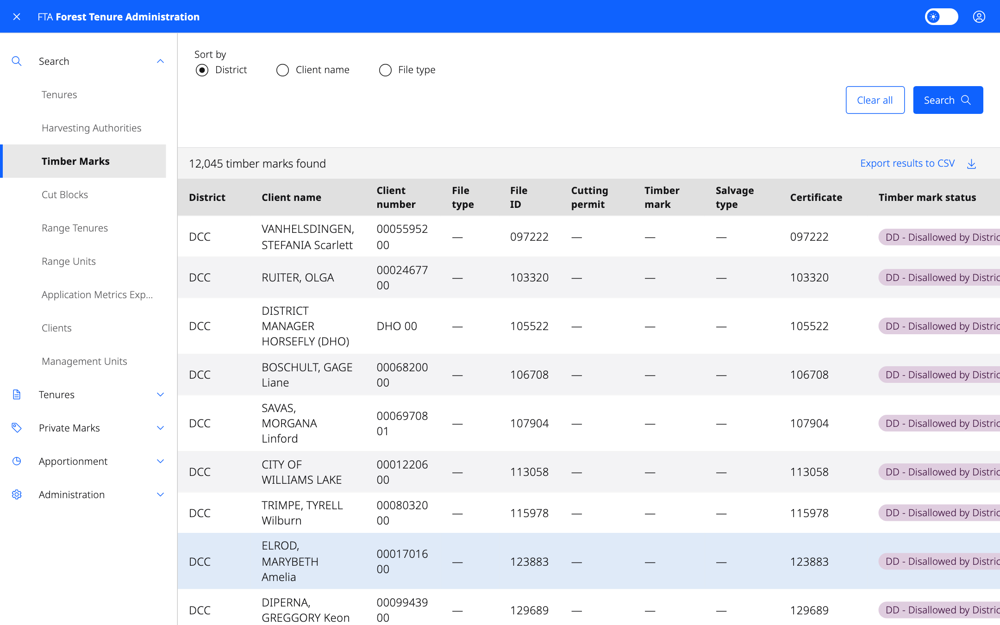
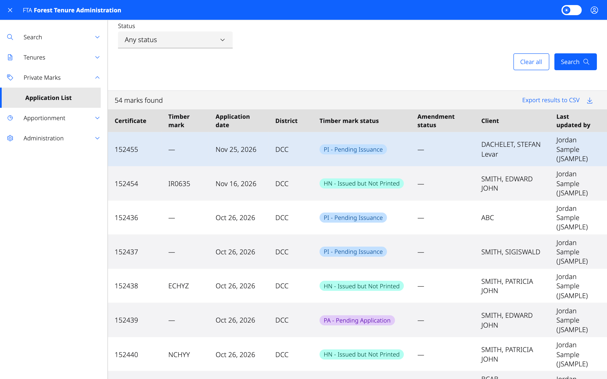
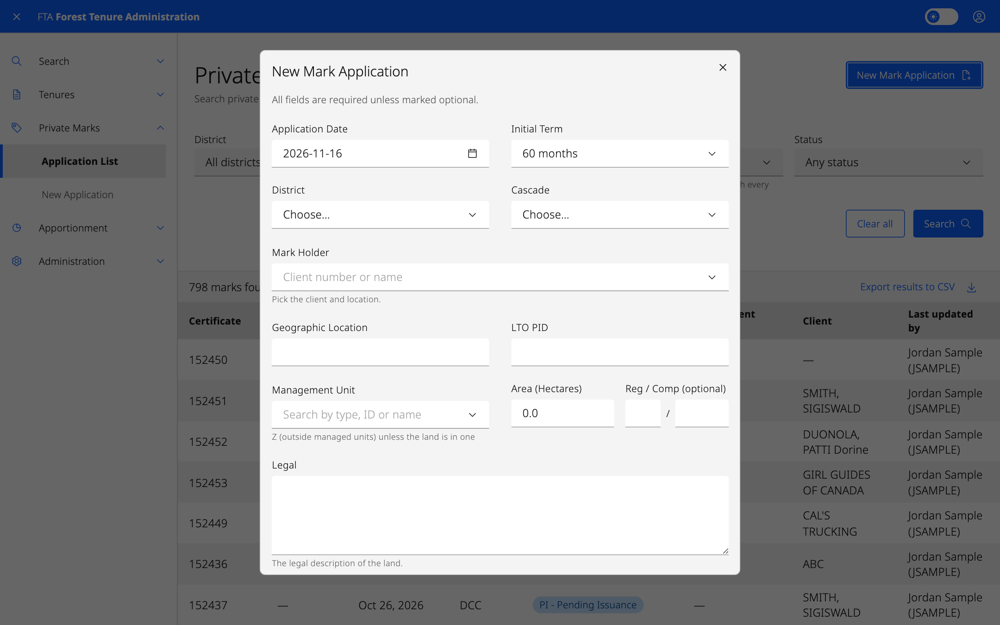
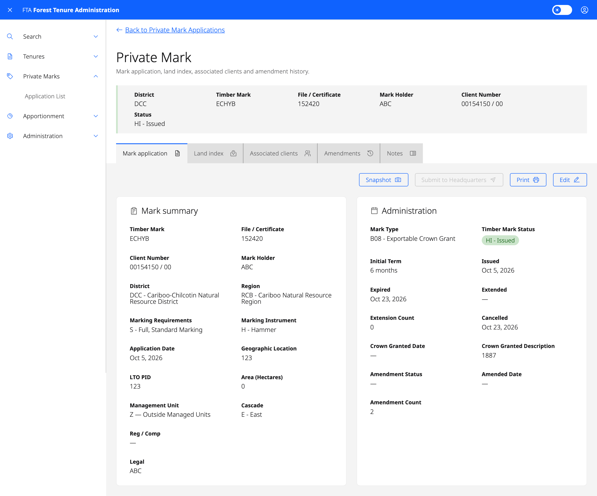
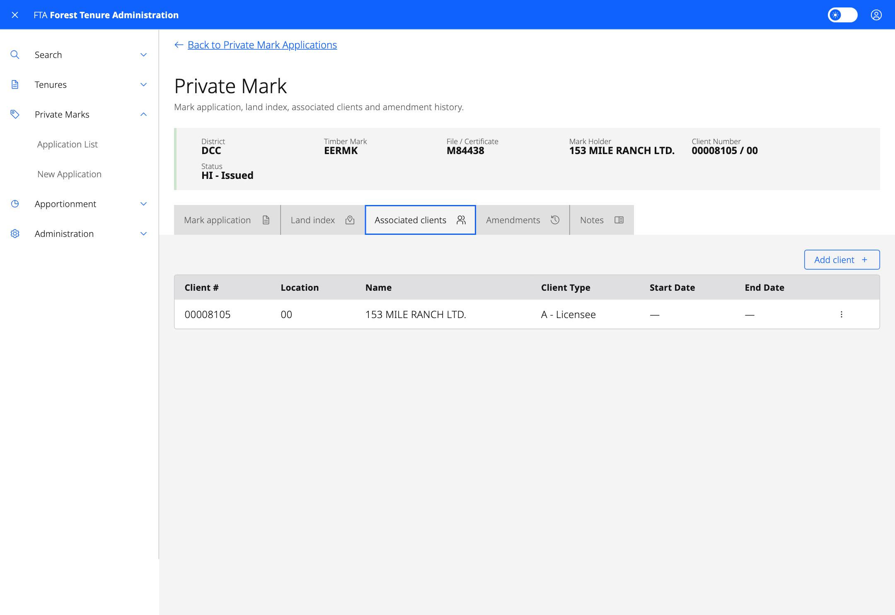
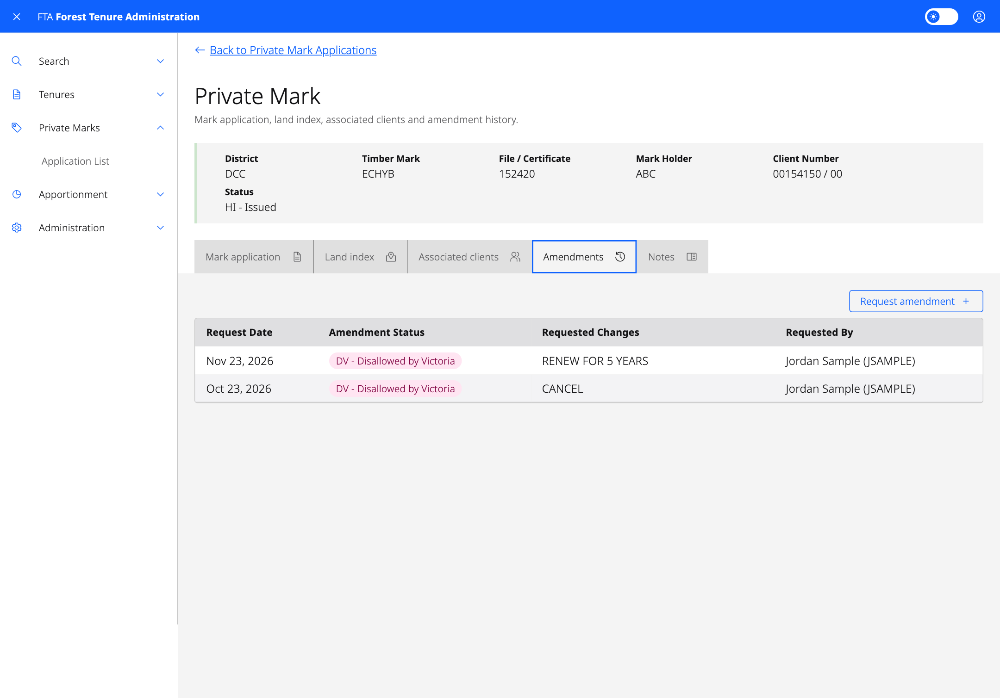

# Timber Marks guide for Headquarters Administrators

For **Timber Mark Headquarters Administrators**, and for **Administrators**,
who have the same timber mark abilities plus Timber Mark Transfer. You
review private mark applications, issue timber marks, approve or disallow
amendments, cancel and reinstate marks, and keep a mark's land index, clients
and notes.

Districts enter applications and submit them to you, and print certificates
once you issue them. Their side of the work is in the Timber Marks guide for
District Administrators.

## Getting started

Open FTA and select **Log in with IDIR** on the landing page. After you sign
in, the **Welcome** page opens. Use the left menu to reach the screens below.
Your name and role are in the profile panel at the top right.

A Timber Mark Headquarters Administrator's menu shows **Search › Tenures**,
**Search › Timber Marks** and **Private Marks**. The tenure and cutting
permit pages a search opens are read-only for that role.

## Screens

| Where to find it | Use it to | Who |
|---|---|---|
| **Search › Timber Marks** | Find timber marks by district, management unit, file, cutting permit, mark, status, client, salvage type, dates and private mark details. Open a result, or export the results to CSV. | Both |
| **Private Marks › Application List** | List private mark applications and amendments by district, timber mark, client or status, and open one. | Both |
| **Administration › Timber Mark Transfer** | Move a forest file and cutting permit's primary timber mark to another file and cutting permit. | Administrator only |

## Common tasks

### Find a timber mark

1. **Search › Timber Marks**.
2. Enter any of the criteria:
   - **District**, **Management unit**, **File ID**, **Cutting permit**,
     **Timber mark**, **File type**, **Mark status**, **Client**,
     **Client type**, **Salvage type** and **Zone**.
   - Under **Date ranges**: **Issue date from** / **to** and
     **Expiry date from** / **to**.
   - Under **Private mark criteria**: **Certificate**, **Land district**,
     **Primary ID**, **Primary detail**, **Amended date from** / **to**, and
     **Only private marks**.
3. Choose a **Sort by** order (**District**, **Client name** or
   **File type**).
4. Select **Search**.

Things to know:

- **District** starts with your default district, if you have one.
- A valid **Timber mark** ignores every other criterion.
- **File ID**, **Cutting permit**, **Timber mark** and **Certificate** match
  in upper or lower case.
- In **Client**, type at least three characters of a client number or name
  and pick from the list; it lists clients with that text anywhere in their
  number or name. If you search without picking, every client whose name
  contains the text is matched.
- **Salvage type** **All — has any salvage type** finds marks with any
  salvage type. **Any** doesn't filter on salvage at all.
- **Amended date** finds marks whose amendment (for example a renewal) was
  approved in that period.
- A "from" date must be on or before its "to" date, or the search stops with
  a message.
- Select a column heading to sort the results by that column.
- **Clear all** empties the criteria and the results.

The results show **District**, **Client name**, **Client number**,
**File type**, **File ID**, **Cutting permit**, **Timber mark**,
**Salvage type**, **Certificate**, **Timber mark status**,
**Amendment status**, **Issue date** and **Expiry date**. With **Only
private marks** ticked, **Cutting permit** and **Salvage type** are left out,
since private marks don't have them.

Select a row to open it:

- A private mark (one with a **Certificate**) opens its private mark page.
- Any other mark opens its tenure.

The page's back link returns you to your search, with the same criteria and
results.

### Export search results

After a search, select **Export results to CSV** above the results. Every
matching row is exported, not just the page on screen, so a large result can
take a moment. The export uses the criteria you last searched with, even if
you have changed a field since.

This works the same on **Private Marks › Application List**.

### Find applications waiting for you

1. **Private Marks › Application List**. The page (**Private Mark
   Applications**) opens on the full list, or on your last search in this
   browser tab.
2. Narrow it with **District**, **Timber mark**, **Client / holder** or
   **Status**. **Status** matches either the timber mark status or the
   amendment status, so **PI** finds both applications and amendments
   waiting for Headquarters.
3. Select **Search**.

The results show **Certificate**, **Timber mark**, **Application date**,
**District**, **Timber mark status**, **Amendment status**, **Client** and
**Last updated by**. Select a row to open the private mark. An application
that hasn't been issued a timber mark yet opens by its certificate.

### Start a new private mark application

1. Select **Private Marks › Application List**, then **New Mark
   Application** at the top of the list. The **New Mark Application** dialog
   opens.
2. Fill in the fields. All are required unless marked optional:
   - **Application Date**: today by default. It can't be later than today.
   - **Initial Term**: 6 to 60 months; 60 by default.
   - **District**. Choosing it fills in the district's usual **Cascade**,
     which you can change.
   - **Mark Holder**: pick the client and location from the list.
   - **Geographic Location** and **LTO PID**.
   - **Management Unit**: Z (outside managed units) unless the land is in
     one.
   - **Area (Hectares)**: 0 to 9999.9, at most one decimal place.
   - **Reg / Comp (optional)**: Reg 0 to 99, Comp 0 to 999.
   - **Legal**: the legal description of the land.
3. Select **Create application**.

FTA confirms "Mark application created" with the new certificate number,
and opens the new application in status **PI - Pending Issuance**, ready to
issue. Marking Requirements and Marking Instrument are set when you issue
the mark.

### Open a private mark

Open the mark from **Search › Timber Marks** or
**Private Marks › Application List**. The page is titled **Private Mark**
(or **Private Mark Application** for one opened by its certificate).

The summary across the top shows **District**, **Timber Mark**,
**File / Certificate**, **Mark Holder**, **Client Number** and **Status**.
Below it are five tabs:

- **Mark application**: the **Mark summary** and **Administration** cards,
  and the buttons **Snapshot**, **Print** and **Edit**.
- **Land index**: where the mark may be used.
- **Associated clients**: the mark's licensees and agents.
- **Amendments**: amendment requests and their status.
- **Notes**: notes on the mark's forest file.

Buttons you can't use right now are disabled.

### Edit a private mark

1. On the **Mark application** tab, select **Edit**. The fields you may
   change become inputs. The other tabs and the back link are locked until
   you finish.
2. Make your changes. All fields are required unless marked optional.
3. Select **Save changes**, or **Cancel** to discard them.

You can save a mark in status **HI**, **HX**, **PI**, **PA** or **HN**. At
other statuses you can still change the status where
[Statuses](#statuses) allows it, and the marking codes. **Timber Mark
Status** can't be changed until the mark has a client on the
**Associated clients** tab. Checks you may see:

- **Issued** is required while the status starts with H.
- **Expired** must be later than **Issued**. Left blank, it is set to
  **Issued** plus the **Initial Term** when you save.
- **Extended** must be later than **Expired**, and blank while the status is
  PI.
- Mark types B08 and B09 need exactly one of **Crown Granted Date** or
  **Crown Granted Description**. A description that is a number counts as a
  year. B08 is before 1906-03-12 (a year of 1906 or earlier); B09 is on or
  after it (a year of 1906 or later).
- **Cancelled** is required to set the status to HX.

If someone else changed the mark since you opened it, the save is refused.
Reload the page and try again.

### Issue a timber mark

On a **PI** or **PA** application that has a client and no mark type yet.

1. On the **Mark application** tab, select **Edit**.
2. Choose the **Mark Type**. The **Timber Mark** shows "Assigned on save".
3. Choose **Marking Requirements** and **Marking Instrument** (both
   required).
4. Select **Save changes**. The **Issue timber mark** dialog shows the
   timber mark the application will get and its mark type.
5. Select **Issue mark**. To skip the number shown (for example, one that
   spells something it shouldn't), select **Generate another** first; the
   skipped number is never used.

Issuing can't be undone. The mark becomes **HN** and **Issued** defaults to
today. If someone else took the number in the meantime, FTA issues the next
one and tells you which. The district then prints the certificate, which
makes the mark **HI**.

### Disallow an application

1. Select **Edit** on a **PI** application.
2. Set **Timber Mark Status** to **DV** (disallowed) or **EE** (entered in
   error).
3. Select **Save changes**.

### Print the certificate

Select **Print** on the **Mark application** tab. The timber mark
certificate downloads as a PDF. **Print** is available once the status
starts with H (HN, HI or HX). Your print doesn't change any status; only a
district's print moves HN to HI.

### Take a snapshot

Select **Snapshot** on the **Mark application** tab. A PDF of everything on
the mark's page downloads, stamped with the date, time and your name.

### Add, update or delete a land index

The land index records the land district and primary ID the mark may be used
on.

1. Open the **Land index** tab and select **Add land index**.
2. Choose the **Land District/Island**. **Primary ID**, **Description**
   (up to 40 characters, such as a parcel or lot) and **Deactivate date
   (optional)** are optional.
3. Select **Add land index**, or **Add additional** to save and enter
   another.

To change an entry, select **Update** on its row, make your changes and
select **Update land index**. To remove one, select **Delete** on its row,
then **Delete** in the **Delete land index?** dialog.

A land index can't be added, updated or deleted while the mark is HX, DV or
DD.

### Add the main licensee and other clients

A mark's first client must be its main licensee, client type **A - Licensee**.

1. Open the **Associated clients** tab and select **Add client**.
2. Pick the **Client** and its location, and choose a **Client type**.
3. Enter the dates the type needs:
   - **A - Licensee** and **B - Joint Venture/Partner**: **Start date**
     required; no end date.
   - **C - Previous Main Licensee**: both dates required.
   - **P - Previous Joint Venture/Partner**: **End date** required.
   - **M - Previous Licensee Operating Division**: an end date is required
     if you give a start date.
   - The end date must be on or after the start date.
4. Select **Add client**.

Adding a new main licensee (A) makes the current one a previous main
licensee (C).

To change a client, open the row's menu and select **Update**. A main (A) or
previous main (C) licensee keeps its client and type; only its dates change.
To remove a previous main licensee, select **Delete** from the row's menu and
confirm. Only previous main licensees (C) can be deleted.

Clients can be added and updated only while the mark is **HI**, **PI** or
**PA**.

### Request an amendment

On an issued (**HI**) mark with no amendment outstanding.

1. Open the **Amendments** tab and select **Request amendment**.
2. Describe the change in **Requested amendment changes** (up to 2000
   characters; saved in upper case).
3. Select **Request amendment**.

The request is saved as **PI - Pending Issuance**.

### Approve or disallow an amendment

1. On the **Mark application** tab, select **Edit**.
2. Set **Amendment Status** to HN (approve) or DV (disallow).
3. Select **Save changes**. The **Amendment status change** dialog asks for
   an optional **Note (optional)**; it is added to the **Notes** tab.
4. Select **Save changes**.

An approved amendment is issued when the district prints the certificate.

A disallowed amendment stays on the **Amendments** tab. The **Administration**
card then shows the latest issued amendment's status and date, if there is
one.

### Cancel or reinstate a mark

To cancel an issued mark:

1. Select **Edit**, set **Timber Mark Status** to HX and enter
   **Cancelled**.
2. Select **Save changes**.

If the mark has a pending (PI) amendment, cancelling approves it (HN). The
dialog for an optional note opens before the save.

Saving a cancelled mark doesn't change who signs its certificate.

To reinstate a cancelled mark, select **Edit**, set **Timber Mark Status**
back to HI (or to PI, DD or DV) and save.

### Add a note

1. Open the **Notes** tab and select **Add note**.
2. Enter the **Note** and select **Add note**.

Notes are added to the mark's forest file and can't be changed afterwards.
An application that has no forest file yet can't take notes.

### Transfer a timber mark

For **Administrators** only.

1. **Administration › Timber Mark Transfer**.
2. Enter the **Source Forest File ID** and **Source Cutting Permit**. The
   mark transferred is that file and cutting permit's primary timber mark.
3. Enter the **Target Forest File ID** and **Target Cutting Permit**.
   Cutting permits are up to 3 characters.
4. Enter the **Legal transfer date**.
5. Select **Transfer mark**. It is available once every field is filled in.

The mark and its tenure data (cut blocks, waste assessment areas, harvest
amendments and so on) move to the target file and cutting permit, and the
transfer is recorded. FTA confirms which mark it moved. **Clear** empties the
form.

FTA refuses the transfer, and lists every reason, when:

- the source file, or the source file and cutting permit, doesn't exist
  ("Invalid Source File.", "Invalid Source File/CP."), or the target file
  doesn't ("Invalid Target File.");
- the source or target file isn't an A type tenure;
- spatial data exists for the source file and cutting permit;
- the target file and cutting permit already exist ("Target File/CP already
  exists.");
- the source and target are the same file and cutting permit;
- the target file is in a different district from the mark (or, for a file
  administered by a region, a different region).

## Statuses

Private marks and their amendments show a status code with its description,
for example **PI - Pending Issuance** or **HI - Issued**.

| Status | What it means here |
|---|---|
| **PA - Pending Application** | A district's application, not yet submitted to you. |
| **PI - Pending Issuance** | Waiting for you to issue or disallow. Also a newly requested amendment. |
| **HN - Issued but Not Printed** | You issued the mark (or approved the amendment); the district hasn't printed the certificate. |
| **HI - Issued** | The mark is live. |
| **HS - Suspended** | The mark is suspended. |
| **HX - Cancelled** | The mark is cancelled. |
| **DV - Disallowed by Victoria** | Headquarters disallowed the application or amendment. |
| **DD - Disallowed by District** | The district disallowed it. |
| **EE - Entered In Error** | The application was entered in error. |

A typical private mark moves:

1. **PA** → **PI** when the district submits it (your own applications start
   at PI).
2. **PI** → **HN** when you issue the mark.
3. **HN** → **HI** when the district prints the certificate.

The status changes you can make in **Edit**:

| From | To |
|---|---|
| PI | DV or EE |
| HI | HX |
| HX | HI, PI, DD or DV |

An amendment goes **PI** → **HN** (approved) or **DV** (disallowed), and
**HN** → **HI** when the district prints the certificate.

Mark types B15 and B16 can only be viewed; no actions are available on them.

## What you can do

| Task | Timber Mark Headquarters Administrator | Administrator |
|---|---|---|
| Search timber marks, list and view private marks, export, snapshot | Yes | Yes |
| Start a new application (starts in PI) | Yes | Yes |
| Edit a mark | At HI, HX, PI, PA or HN | Same |
| Issue a mark; change its status; approve or disallow an amendment | Yes | Yes |
| Print the certificate (no status change) | Yes | Yes |
| Add, update or delete a land index | Except at HX, DV, DD | Same |
| Add or update clients | At HI, PI or PA | Same |
| Request an amendment | On an HI mark | Same |
| Add a note | Yes | Yes |
| Submit to Headquarters | No; districts do this | No |
| Transfer a timber mark | No | Yes |
